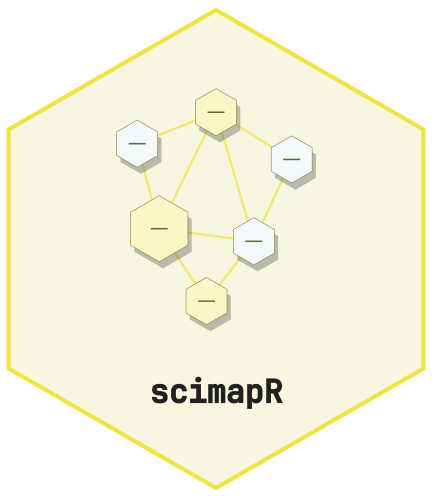
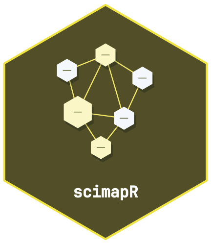

<!-- cttir-vignette-logo: start -->
<style>
.cttir-vignette-logo { float: right; width: 120px; max-width: 30%; margin: 0 0 1rem 1.5rem; }
.cttir-vignette-logo img { width: 100%; height: auto; border: 0; background: transparent; box-shadow: none; }
.cttir-vignette-logo .cttir-vignette-logo-light { display: block; }
.cttir-vignette-logo .cttir-vignette-logo-dark { display: none; }
@media (prefers-color-scheme: dark) {
  .cttir-vignette-logo .cttir-vignette-logo-light { display: none; }
  .cttir-vignette-logo .cttir-vignette-logo-dark { display: block; }
}
[data-bs-theme="light"] .cttir-vignette-logo .cttir-vignette-logo-light { display: block; }
[data-bs-theme="light"] .cttir-vignette-logo .cttir-vignette-logo-dark { display: none; }
[data-bs-theme="dark"] .cttir-vignette-logo .cttir-vignette-logo-light { display: none; }
[data-bs-theme="dark"] .cttir-vignette-logo .cttir-vignette-logo-dark { display: block; }
</style>
<div class="cttir-vignette-logo">
  
  
</div>
<!-- cttir-vignette-logo: end -->

<!-- badges: start -->
[](https://github.com/CTTIR/scimapR/actions/workflows/R-CMD-check.yaml)
[](https://cttir.github.io/scimapR/)
[](https://CRAN.R-project.org/package=scimapR)
[](https://app.codecov.io/gh/CTTIR/scimapR?branch=main)
[](https://cran.r-project.org/package=scimapR)
[](https://cran.r-project.org/package=scimapR)
[](https://opensource.org/licenses/MIT)
[](https://lifecycle.r-lib.org/articles/stages.html#experimental)
<!-- badges: end -->

```{r, include = FALSE}
knitr::opts_chunk$set(
  collapse = TRUE,
  comment = "#>",
  fig.width = 7,
  fig.height = 5
)
```

## Equity and representation audit

scimapR includes built-in tools for auditing geographic, gender, funding,
and open-access representation -- with explicit confidence reporting and
limitation caveats.

```{r setup}
library(scimapR)
corpus <- sm_example_corpus(seed = 42)
```

### Geographic audit

```{r geo}
geo <- sm_audit_geographic(corpus)
head(geo)
```

### Open access audit

```{r oa}
oa <- sm_audit_oa(corpus)
head(oa)
```

### Equity dashboard

```{r dashboard, fig.width = 8, fig.height = 6, fig.cap = "Equity dashboard"}
sm_plot_equity_dashboard(corpus)
```

### Epistemic humility

All audit functions report confidence, method, and caveats. The print
methods include explicit limitation blocks. scimapR does not pretend
that automated inference is ground truth.

## Author trajectory analysis

scimapR can track an author's career evolution through topic pivots,
collaborator turnover, and productivity curves.

```{r trajectory}
# The example corpus includes a trajectory seed author
traj <- sm_author_trajectory(corpus, author_id = "A000000001")
print(traj)
```

```{r traj-plot, fig.width = 8, fig.height = 6, fig.cap = "Author trajectory"}
sm_plot_trajectory(traj)
```

## LLM-grounded corpus chat

scimapR can use an LLM to answer questions about a corpus, with every
claim anchored to actual works via retrieval-constrained citations.

```r
# Requires ellmer package
response <- sm_chat(
  corpus,
  "What methodological approaches dominate post-2020?",
  provider = ellmer::chat_anthropic()
)
print(response)
```

The LLM only sees works that were actually retrieved. Citations are
constrained to those retrieved works -- no hallucinated references are
possible.
